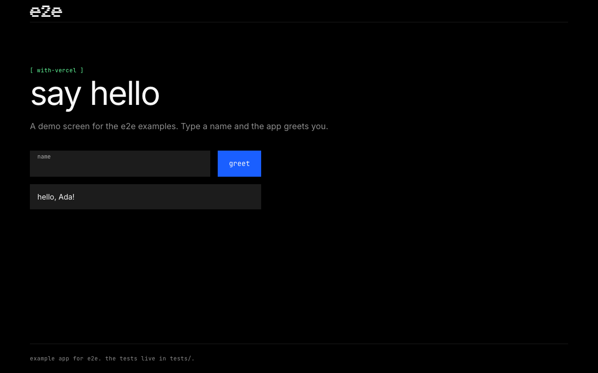

# e2e with Vercel

A Next.js App Router greeting app, ready to deploy on Vercel, with e2e tests
that run against your local dev server or any deployment URL. It has three
locator tests and two agent tests.

[](https://vercel.com/new/clone?repository-url=https%3A%2F%2Fgithub.com%2Fe2e-inc%2Fe2e-vercel)



## The tests

- [tests/deterministic.e2e.ts](tests/deterministic.e2e.ts) uses locators to
  check the form, the empty-name error, and the greeting. It needs no model.
- [tests/agentic.e2e.ts](tests/agentic.e2e.ts) asks the agent to get a
  greeting and to find the empty-name error. Each agent step is paired with a
  locator check that doesn't depend on the model.

## Testing every deployment

[.github/workflows/e2e.yml](.github/workflows/e2e.yml) runs the tests
against every Vercel deployment, preview and production. Vercel starts it with
a `vercel.deployment.ready`
[repository dispatch event](https://vercel.com/docs/git/vercel-for-github#repository-dispatch-events)
once a deployment has built. On each run it:

1. Sets a pending commit status named `e2e - preview` or `e2e - production`
   on the deployed commit.
2. Checks out that commit and installs dependencies and Chromium.
3. Runs `npx e2e run --reporter list,junit --video on` with `APP_URL` set
   to the deployment's URL, recording a video of each test.
4. Posts the results as a comment on the deployment's pull request with the
   [`@e2e-dev/github` reporter](https://e2e.com/docs/github), and writes them
   to the job summary. A new run updates the same comment.
5. Uploads `.e2e/report.json`, `.e2e/junit.xml`, and `.e2e/results` as an
   artifact, and sets the commit status to the result.

Vercel's event doesn't name a pull request, so the workflow finds the open
pull request for the deployed commit and passes it to the reporter.

The replay cache in `.e2e/cache` is committed. The agent's steps replay from it
in CI instead of calling the model again, until the app or the test changes.
`app.identity` in [e2e.config.ts](e2e.config.ts) keeps the cache valid across
deployment URLs.

A [Deployment Check](https://vercel.com/docs/deployment-checks) on the
`e2e - production` status keeps a production deployment off your production
domains until its tests pass. When they fail, the previous deployment stays
live.

### Set it up for your project

1. Deploy with the button above, or import your copy of the repository into
   Vercel.
2. In **Settings → Git**, turn on **repository_dispatch events**.
3. In **Settings → Deployment Protection**, add a **Protection Bypass for
   Automation** secret. The tests send it in the `x-vercel-protection-bypass`
   header, so they can open protected deployments.
4. In GitHub, under **Settings → Secrets and variables → Actions**, add the
   bypass secret as `VERCEL_AUTOMATION_BYPASS_SECRET` and a
   [Vercel AI Gateway](https://vercel.com/docs/ai-gateway) key as
   `AI_GATEWAY_API_KEY`. Without the key, the agent tests skip.
5. In **Settings → Build and Deployment → Deployment Checks**, select **Add
   Checks**, choose **GitHub**, and select `e2e - production`. The status shows
   up there after the workflow's first run.

## Agent tests and the AI Gateway

The agent uses `openai/gpt-6-luna-fast` through the
[Vercel AI Gateway](https://vercel.com/docs/ai-gateway). It reads
`AI_GATEWAY_API_KEY`. In a linked Vercel project, a `VERCEL_OIDC_TOKEN` from
`vercel env pull` works too. e2e doesn't load `.env` files, so export the
variable in your shell.

Without a key or a token, the agent tests skip and the locator tests still run.

## Run locally

Use Node 22.22.3+, 24.8+, or 26+. From this folder:

```bash
npm install
AI_GATEWAY_API_KEY="your-key" npm run test:e2e
```

The runner starts the app at `http://localhost:3100` and downloads Chromium on
the first run if needed. Leave out the key to run only the locator tests. Add
`-- --no-cache` to use fresh model calls. Results are in `.e2e/report.json`.

## Test a deployment

Set `APP_URL` to test a deployed app, such as a Vercel preview URL, instead
of the local dev server:

```bash
APP_URL="https://your-app.vercel.app" npm run test:e2e
```

See [e2e.config.ts](e2e.config.ts) and [tests/](tests/) for the setup.

## License

[MIT](LICENSE)

Last checked with e2e 0.23.1, @e2e-dev/web 0.16.0, Next.js 16.4, and Node 24.

<a href="https://e2e.com">
  <picture>
    <source media="(prefers-color-scheme: dark)" srcset="e2e-logo-white.png">
    
  </picture>
</a>
